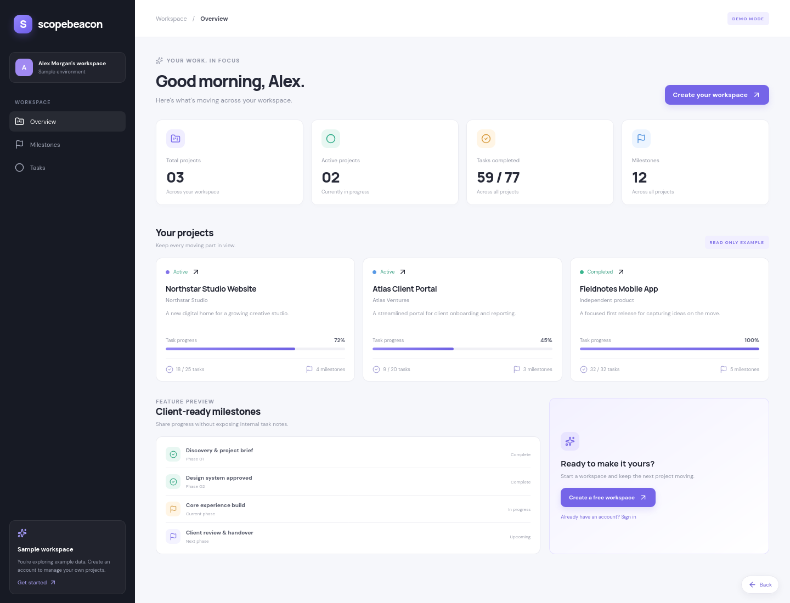

# ScopeBeacon

**Project delivery, clearly.**

ScopeBeacon is a full-stack project workspace for independent developers and small teams. Organize client work, track delivery and share progress without exposing internal task notes.



## Why ScopeBeacon

Client updates should not require another meeting, another account or access to your internal workspace. ScopeBeacon gives developers a private delivery workspace and clients a clean, read-only progress page.

## Features

- Email/password registration, login and logout
- Project dashboard with delivery metrics
- Project creation and status management
- Task creation and completion tracking
- Milestone creation and status progression
- Private project activity timeline
- Revocable client progress links
- Read-only client view with milestones and aggregate progress
- Responsive desktop and mobile interface
- Sample workspace at `/demo`

## Stack

| Layer | Technology |
|---|---|
| Frontend | React 19, TypeScript, Vite 8 |
| API | Hono 4, Node.js |
| Database | SQLite via Node's built-in `node:sqlite` |
| Validation | Zod |
| Authentication | scrypt password hashes, random server-side sessions, HttpOnly cookies |
| Tests | Vitest |
| CI | GitHub Actions |

## Run locally

Requirements: Node.js 26 and npm.

```bash
npm ci
cp .env.example .env
npm run dev
```

The development environment starts:

- Web app: http://127.0.0.1:5173
- API health: http://127.0.0.1:5173/api/health
- Sample workspace: http://127.0.0.1:5173/demo

The API runs separately on port 8792 and Vite proxies `/api` requests. SQLite is created automatically at `data/scopebeacon.sqlite`; the database and environment file are excluded from Git.

## Verify

With the development server running:

```bash
npm test
npm run typecheck
npm run build
npm run smoke
npm audit --audit-level=high
```

The smoke test exercises registration, project creation, task/milestone creation, client sharing, aggregate progress, privacy boundaries and share revocation. It also checks frontend routes and built assets. Set `SMOKE_URL` to target another running instance.

## Production-style local run

```bash
npm run build
NODE_ENV=production npm start
```

The Node server serves the compiled frontend and API from the same origin. Set `PORT` and `DB_PATH` in the environment or `.env` file. Use a persistent disk for the SQLite database and back it up regularly.

## Documentation

- [Architecture](docs/ARCHITECTURE.md)
- [API reference](docs/API.md)
- [Security posture and production checklist](docs/SECURITY.md)
- [Contributing](CONTRIBUTING.md)

## Security and production readiness

The MVP includes salted scrypt password hashing, hashed random session tokens, session expiry/revocation, HttpOnly cookies, server-side validation, per-user ownership checks and a deliberately restricted public client response.

Before real client data is stored, add persistent rate limiting, email verification and password reset, operational monitoring, automated backups/restore testing, privacy and retention policies, and a reviewed deployment configuration. See [SECURITY.md](docs/SECURITY.md).

## Attribution

Original application and implementation by Marcelo Bregoli. Third-party dependencies retain their respective licenses. Licensed under MIT.
